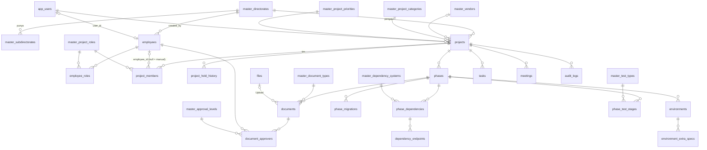

# PMO App — Spesifikasi API & Database
**Cakupan:** menu **Dashboard**, **Project** (list + detail semua tab), **Master Data**
**Backend:** Golang + PostgreSQL · **Frontend:** Next.js (kode di `app/`, `components/`, `lib/`)
**File pendamping:** `pmo-schema.sql` (DDL lengkap + seed, sudah diuji jalan di PostgreSQL 16)

> Dokumen ini disusun dari kode yang benar-benar dipakai UI (`app/dashboard/page.tsx`, `app/projects/page.tsx`,
> `app/projects/[id]/page.tsx`, `app/master-data/page.tsx`, `components/master-data/*`, `lib/mock-data.ts`, `lib/access.ts`),
> bukan dari asumsi. ID di contoh JSON ditulis singkat (`prj-1`) supaya terbaca; di sistem nyata semuanya **UUID**.

---

## 1. Temuan penting dari kode (ini yang bikin desain beda dari mock)

Baca bagian ini dulu — beberapa poin mengubah kontrak API.

1. **`lib/mock-data.ts` di zip belum sinkron dengan kodenya.** `page.tsx` memakai `Member.employeeId`, dan `lib/access.ts`
   memakai `Project.createdBy` + `Employee.userId` — tiga field itu belum ada di tipe `mock-data.ts`. Skema DB mengikuti yang
   *dipakai kode* (`projects.created_by`, `project_members.employee_id`, `employees.user_id`).
2. **Project menyimpan master sebagai NAMA string** (`directorate: "Direktorat Teknologi Informasi"`, `vendor`, `category`, ...).
   Di DB harus FK `id`, kalau tidak, ganti nama di Master Data memutus semua project. Konvensi API: **baca = nama + id, tulis = `*Id`**
   (jadi tampilan FE hampir tidak berubah, hanya payload form yang berubah).
3. **Status project punya dua jalur yang tidak konsisten.** Form *Ubah* di list project punya field `status` (tanpa alasan Hold, tanpa
   riwayat hold), sedangkan tombol *Ubah Status* di detail membuat `holdHistory`. → API cuma punya **satu** jalur: `POST /projects/{id}/status`.
   `PATCH /projects/{id}` **menolak** field `status`. FE: hapus field status dari form Ubah di list.
4. **Hold → Cancelled dianggap "resume".** Di `submitStatusChange`, pindah dari Hold ke status apa pun selain Hold menutup hold aktif
   (`resumedAt` terisi), termasuk ke *Cancelled*. Spesifikasi ini mengikuti perilaku itu; ubah kalau bukan maksudmu.
5. **Angka progress tidak punya input di UI.** `PhaseModal` hanya mengedit nama/tahap/tanggal/scope/catatan. `overallProgress`,
   `progressPercent`, `documentProgress`, `developmentProgress`, `testingProgress` tidak diisi dari mana pun → harus diputuskan
   (lihat §11, keputusan #1). Sementara kolomnya ada di DB dan API memperlakukannya **read-only**.
6. **`approvalLevel` ("2/3") tidak pernah dihitung ulang.** Diset `"0/0"` saat dokumen dibuat dan tidak berubah saat approver
   ditambah/disetujui. → dihitung server tiap query (jumlah `Disetujui` / jumlah approver), tidak disimpan.
7. **Dokumen "Upload" cuma menyimpan nama file** (mock). Butuh endpoint upload sungguhan (§8.9).
8. **`DataTable` memproses search/sort/filter/pagination di browser.** Untuk data besar harus pindah ke server (list project,
   pegawai, task, riwayat). Kontrak list di §2.5.
9. **Komponen Master Data memakai index array sebagai identitas** (`rowKey="index"`, `handleDelete(index)`). Dengan backend harus
   `id`. Tipe union TS (`ProjectCategory`, `ProjectPriority`, `DocType`, `TestType`) juga harus jadi `string`, karena isinya bisa diubah admin.
10. **Role PMO tidak punya akses menu Master Data** (`master-data: view false`), padahal form project butuh daftar direktorat,
    vendor, kategori, dst. → endpoint baca untuk dropdown **terpisah** dari CRUD admin: `GET /lookups` (§5.1).
11. **Role PMO `delete: false` di menu Project**, tapi UI mengizinkan PMO menghapus dokumen/environment/dst. → hapus *item di dalam
    project* butuh `projects.edit`; hanya `DELETE /projects/{id}` yang butuh `projects.delete`.
12. **Riwayat dikaitkan lewat `projectName`** (`auditLogs.filter(a => a.projectName === project.name)`). Ganti nama project = riwayat putus.
    → pakai `project_id`.
13. **Dashboard:** tabel "Project Berjalan" menampilkan *semua* status (termasuk Hold/Cancelled), dan "Rapat Mendatang" tidak memfilter
    tanggal (rapat `Scheduled` yang sudah lewat tetap muncul). Spesifikasi ini mempertahankan perilaku tabel, tapi memfilter rapat `>= now`.
14. **`masterEnvironmentTypes` ada di `mock-data.ts` tapi tidak ada di halaman Master Data.** Kategori environment dikunci di
    kode (`ENV_FIELD_VISIBILITY`) → dibuat enum tetap, bukan master.
15. **Pembuatan project:** FE membuat "Fase 1" default (mulai hari ini, target +90 hari). Pindahkan ke server dalam satu transaksi.
16. **Aturan akses harus ditegakkan backend** (`lib/access.ts` sendiri bilang begitu). Menyembunyikan di FE hanya UX.

---

## 2. Konvensi API

### 2.1 Dasar
| Hal | Aturan |
|---|---|
| Base URL | `/api/v1` |
| Auth | `Authorization: Bearer <access_token>` (JWT) |
| Format | JSON, `Content-Type: application/json`; field **camelCase** (sama dengan tipe TS yang sudah ada) |
| ID | UUID string |
| Tanggal | `YYYY-MM-DD` (sama dengan `dayjs.format("YYYY-MM-DD")` di FE) |
| Waktu | ISO 8601 **dengan offset**, mis. `2026-09-24T10:00:00+07:00` (di DB `timestamptz`) |
| Update | `PATCH` = parsial (kirim field yang berubah saja). Array (`scope`, `endpoints`, `extraSpecs`) **diganti utuh** |
| Respons mutasi | Objek terbaru di `data` (200/201). `DELETE` → `204` tanpa body |

### 2.2 Envelope
```json
{ "data": { } }
```
```json
{ "data": [ ], "meta": { "page": 1, "pageSize": 10, "total": 37 } }
```

### 2.3 Error
```json
{
  "error": {
    "code": "VALIDATION_ERROR",
    "message": "Data tidak valid.",
    "fields": { "name": "Wajib diisi", "subdirectorateId": "Subdit bukan milik direktorat ini" },
    "details": null
  }
}
```
| HTTP | `code` | Perilaku FE |
|---|---|---|
| 400 | `BAD_REQUEST` | tampilkan pesan |
| 401 | `UNAUTHENTICATED` | arahkan ke `/login` (halaman `app/401` sudah ada) |
| 403 | `FORBIDDEN` | halaman `app/403` |
| 404 | `NOT_FOUND` | `ErrorState 404` di detail project (sudah ada). **Project yang tidak boleh diakses juga dibalas 404**, supaya keberadaannya tidak bocor |
| 409 | `DUPLICATE`, `IN_USE`, `INVALID_STATE` | pesan; `IN_USE` membawa daftar referensi (§5.3) |
| 422 | `VALIDATION_ERROR` | petakan `fields` ke `form.setFields([...])` antd |
| 500 | `INTERNAL` | `ErrorState 500` |

### 2.4 Hak akses
Dua lapis, dicek backend di setiap endpoint:

1. **Permission menu** — dari role (`role_permissions`): `menuKey.action`, mis. `projects.edit`. Pengguna dengan banyak role = gabungan (OR).
2. **Data scope project** — sebuah project hanya bisa diakses jika salah satu benar (`lib/access.ts`):
   * pengguna punya role **Administrator**, atau
   * `projects.created_by = pengguna`, atau
   * pengguna adalah anggota tim project itu sebagai **PMO / Developer** (rantai `app_users.id ← employees.user_id ← project_members.employee_id`).
   Anggota role `User` dan developer vendor hanya data, tidak login.

Predikat SQL yang dipakai di *semua* query project/dashboard (`$1` = id pengguna; sudah diuji):
```sql
p.deleted_at is null and (
  exists (select 1 from user_roles ur join roles ro on ro.id = ur.role_id
          where ur.user_id = $1 and ro.name = 'Administrator')
  or p.created_by = $1
  or exists (select 1
             from project_members m
             join employees e on e.id = m.employee_id
             join master_project_roles r on r.id = m.project_role_id
             where m.project_id = p.id and e.user_id = $1 and r.code in ('PMO','DEVELOPER'))
)
```

### 2.5 Kontrak list (server-side)
Query: `page` (mulai 1, default 1) · `pageSize` (default 10 — sama dengan `defaultPageSize` DataTable, maks 100) · `q` (pencarian) ·
`sort` (`field` naik, `-field` turun) · filter spesifik per endpoint. Respons memakai envelope `meta` di §2.2.
Di FE: tambahkan mode *server-side* di `DataTable` (`onChange` → ubah query, jangan filter lokal).

### 2.6 Prasyarat: autentikasi
Halaman `app/login` sudah ada dan `lib/access.ts` masih memakai `currentUser = appUsers[0]` (stub). Kontrak minimal yang dibutuhkan
tiga menu ini (sisanya milik menu Manajemen User):
`POST /auth/login`, `POST /auth/refresh`, `POST /auth/logout`, dan:

**`GET /auth/me`**
```json
{
  "data": {
    "id": "usr-1",
    "name": "Rani Kusuma",
    "email": "rani.kusuma@company.co.id",
    "roles": ["PMO"],
    "isAdministrator": false,
    "permissions": {
      "dashboard":   { "view": true,  "create": false, "edit": false, "delete": false },
      "projects":    { "view": true,  "create": true,  "edit": true,  "delete": false },
      "master-data": { "view": false, "create": false, "edit": false, "delete": false }
    }
  }
}
```
FE memakainya untuk menyembunyikan menu/tombol (UX saja; backend tetap mengecek).

---

## 3. Indeks endpoint

| # | Method & path | Permission | Dipakai di FE |
|---|---|---|---|
| | **Umum** | | |
| 1 | `GET /auth/me` | login | AppShell, semua halaman |
| 2 | `GET /lookups` | login | semua dropdown master di form project |
| | **Dashboard** | | |
| 3 | `GET /dashboard` | `dashboard.view` | `app/dashboard/page.tsx` |
| | **Project (list)** | | |
| 4 | `GET /projects` | `projects.view` | `app/projects/page.tsx` |
| 5 | `POST /projects` | `projects.create` | `handleSubmit` (tambah) |
| 6 | `PATCH /projects/{id}` | `projects.edit` | `handleSubmit` (ubah) · `saveDetails` di detail |
| 7 | `DELETE /projects/{id}` | `projects.delete` | `handleDelete` |
| | **Project (detail)** | | |
| 8 | `GET /projects/{id}` | `projects.view` + scope | `app/projects/[id]/page.tsx` |
| 9 | `POST /projects/{id}/status` | `projects.edit` | `submitStatusChange` |
| 10 | `POST /projects/{id}/members` | `projects.edit` | `saveMember` (tambah) |
| 11 | `PATCH /members/{id}` | `projects.edit` | `saveMember` (ubah) |
| 12 | `DELETE /members/{id}` | `projects.edit` | `deleteMember` |
| 13 | `POST /projects/{id}/phases` | `projects.edit` | `savePhase` (tambah) |
| 14 | `PATCH /phases/{id}` | `projects.edit` | `savePhase` (ubah) |
| 15 | `POST /phases/{id}/environments` | `projects.edit` | `saveEnvironment` |
| 16 | `PATCH /environments/{id}` | `projects.edit` | `saveEnvironment` |
| 17 | `DELETE /environments/{id}` | `projects.edit` | `deleteEnvironment` |
| 18 | `POST /phases/{id}/documents` | `projects.edit` | `saveDocument` |
| 19 | `PATCH /documents/{id}` | `projects.edit` | `saveDocument` |
| 20 | `DELETE /documents/{id}` | `projects.edit` | `deleteDocument` |
| 21 | `POST /documents/{id}/approvers` | `projects.edit` | `addApprover` |
| 22 | `PATCH /approvers/{id}` | `projects.edit` | `changeApproverStatus` |
| 23 | `DELETE /approvers/{id}` | `projects.edit` | `deleteApprover` |
| 24 | `POST /phases/{id}/migrations` | `projects.edit` | `saveMigration` |
| 25 | `PATCH /migrations/{id}` | `projects.edit` | `saveMigration` |
| 26 | `DELETE /migrations/{id}` | `projects.edit` | `deleteMigration` |
| 27 | `POST /phases/{id}/dependencies` | `projects.edit` | `saveDependency` |
| 28 | `PATCH /dependencies/{id}` | `projects.edit` | `saveDependency` |
| 29 | `DELETE /dependencies/{id}` | `projects.edit` | `deleteDependency` |
| 30 | `GET /projects/{id}/tasks` | `projects.view` + scope | tab Task & Rapat |
| 31 | `PATCH /tasks/{id}/review` | `projects.edit` + scope | `saveReview` |
| 32 | `GET /projects/{id}/meetings` | `projects.view` + scope | tab Task & Rapat |
| 33 | `GET /projects/{id}/audit-logs` | `projects.view` + scope | tab Riwayat |
| 34 | `POST /files` | `projects.edit` | `DocumentModal` (Upload) |
| 35 | `GET /files/{id}` | `projects.view` + scope | tombol buka dokumen |
| | **Master Data** | | |
| 36 | `GET /master/{resource}` | `master-data.view` | `*Crud` (list) |
| 37 | `POST /master/{resource}` | `master-data.create` | `*Crud` (tambah) |
| 38 | `PATCH /master/{resource}/{id}` | `master-data.edit` | `*Crud` (ubah) |
| 39 | `DELETE /master/{resource}/{id}` | `master-data.delete` | `*Crud` (hapus) |
| 40 | `GET /employees` | `master-data.view` **atau** `projects.view` | `EmployeesCrud` · `MemberModal` · `ApproverAddForm` |
| 41 | `POST /employees` · `PATCH /employees/{id}` · `DELETE /employees/{id}` | `master-data.create/edit/delete` | `EmployeesCrud` |

Tidak dipakai UI saat ini tapi disarankan ada: `DELETE /phases/{id}` (`projects.edit`; `PhaseCard` belum punya tombol hapus).

---

## 4. Dashboard

### `GET /dashboard`
Permission `dashboard.view`. Hanya menghitung project yang **boleh diakses pengguna** (§2.4) — admin melihat semuanya.
Satu request menggantikan semua perhitungan yang sekarang dilakukan di browser dari array `projects`.

Query opsional: `projectLimit` (default 10) — jumlah baris untuk grafik batang dan tabel; `meetingLimit` (default 5).

```json
{
  "data": {
    "summary": {
      "totalProjects": 3,
      "activeProjects": 2,
      "holdProjects": 1,
      "cancelledProjects": 0,
      "averageProgress": 54
    },
    "statusDistribution": [
      { "status": "Active", "count": 2 },
      { "status": "Hold", "count": 1 },
      { "status": "Cancelled", "count": 0 }
    ],
    "progressPerProject": [
      { "id": "prj-1", "name": "Core Banking Integration Portal", "progress": 62 },
      { "id": "prj-2", "name": "HR Employee Self Service", "progress": 34 }
    ],
    "projects": [
      {
        "id": "prj-1",
        "name": "Core Banking Integration Portal",
        "directorate": "Direktorat Teknologi Informasi",
        "subdirectorate": "Subdit Development",
        "status": "Active",
        "currentPhase": { "id": "ph-1b", "name": "Fase 2", "stage": "Dokumen" },
        "overallProgress": 62
      }
    ],
    "upcomingMeetings": [
      {
        "id": "m1",
        "projectId": "prj-1",
        "projectName": "Core Banking Integration Portal",
        "title": "Review FSD Fase 2",
        "category": "Dokumen",
        "date": "2026-09-24T10:00:00+07:00"
      }
    ]
  }
}
```

Pemetaan ke UI:

| Elemen UI | Field |
|---|---|
| 4 kartu `Statistic` | `summary.*` |
| Pie "Distribusi Status" | `statusDistribution` (FE membuang yang `count = 0`, seperti sekarang) |
| Bar "Progress per Project" | `progressPerProject` (FE tetap yang memotong nama > 16 karakter) |
| Tabel "Project Berjalan" | `projects` |
| "Rapat Mendatang" | `upcomingMeetings` |

Aturan:
* `averageProgress` = `round(avg(overall_progress))`, **0 jika belum ada project** (FE sekarang menghasilkan `NaN` karena bagi nol).
* `currentPhase` = fase dengan `sort_order` terbesar — sama dengan perilaku FE sekarang (`phases[phases.length - 1]`).
* `upcomingMeetings` = `status = 'Scheduled' AND scheduled_at >= now()`, urut tanggal naik, dibatasi `meetingLimit`.
* Urutan `projects` / `progressPerProject` (asumsi, tidak ditentukan kode): priority tertinggi dulu, lalu nama.
* Query inti (`$1` = pengguna, `ap` = predikat §2.4):
```sql
-- summary
select count(*)                                   as total,
       count(*) filter (where status = 'Active')    as active,
       count(*) filter (where status = 'Hold')      as hold,
       count(*) filter (where status = 'Cancelled') as cancelled,
       coalesce(round(avg(overall_progress)), 0)    as avg_progress
from projects p where /* ap */;

-- fase berjalan per project
select distinct on (project_id) project_id, id, name, stage
from phases where project_id = any($2)
order by project_id, sort_order desc;
```

---

## 5. Master Data

### 5.1 `GET /lookups` — sumber dropdown (semua pengguna login)
Menggantikan `masterDirektorat`, `getSubditOptions`, `masterVendors`, `masterProjectCategories`, `masterProjectPriorities`,
`masterDocumentTypes`, `masterApprovalLevels`, `masterDependencySystems`, dst yang sekarang di-import langsung di halaman.
Hanya baris `isActive = true`, urut `sortOrder`. **Pegawai tidak dimasukkan** (bisa ribuan; pakai `GET /employees` dengan pencarian, §5.5).
Cache sisi klien (React Query/SWR); invalidasi setelah ada mutasi master.

```json
{
  "data": {
    "directorates": [{ "id": "dir-1", "name": "Direktorat Teknologi Informasi" }],
    "subdirectorates": [{ "id": "sub-1", "name": "Subdit Development", "directorateId": "dir-1" }],
    "vendors": [{ "id": "ven-1", "name": "PT Solusi Digital Nusantara" }],
    "projectCategories": [{ "id": "cat-1", "name": "Support" }],
    "projectPriorities": [{ "id": "pri-3", "name": "Tinggi", "level": 3 }],
    "approvalLevels": [{ "id": "lvl-1", "name": "Staff" }],
    "projectRoles": [{ "id": "role-1", "code": "PMO", "name": "PMO" }],
    "taskCategories": [{ "id": "tc-1", "name": "Development" }],
    "meetingCategories": [{ "id": "mc-1", "name": "Dokumen" }],
    "dependencySystems": [{ "id": "ds-1", "name": "Axway", "isOther": false }, { "id": "ds-9", "name": "Lainnya", "isOther": true }],
    "documentTypes": [{ "id": "dt-1", "code": "BR", "description": "Business Requirement" }],
    "testTypes": [{ "id": "tt-2", "code": "SIT", "requiresPrevious": true, "allowParallel": false }]
  }
}
```
`getSubditOptions(directorate)` di FE tinggal `subdirectorates.filter(s => s.directorateId === dipilih)`.

### 5.2 CRUD master (13 tab)
Dua belas resource memakai pola yang sama di bawah `/master/{resource}`; Master Pegawai punya endpoint sendiri (§5.5).

| Tab di UI | `{resource}` | Payload tulis | Unik | Dipakai oleh (hapus → 409 jika ada) |
|---|---|---|---|---|
| Jenis Dokumen | `document-types` | `code`, `description` | `code` (tanpa beda huruf besar) | `documents` |
| Jenis Testing | `test-types` | `code`, `requiresPrevious`, `allowParallel` | `code` | `phase_test_stages` |
| Level Approval | `approval-levels` | `name` | `name` | `document_approvers` |
| Direktorat | `directorates` | `name` | `name` | subdit, pegawai, project, anggota tim, akun |
| Subdit | `subdirectorates` | `directorateId`, `name` | (`directorateId`, `name`) | pegawai, project, anggota tim, akun |
| Role Project | `project-roles` | `name` *(code read-only; baris sistem tidak bisa dihapus)* | `name` | `employee_roles`, `project_members` |
| Kategori Task | `task-categories` | `name` | `name` | `tasks` |
| Kategori Meeting | `meeting-categories` | `name` | `name` | `meetings` |
| Master Vendor | `vendors` | `name` | `name` | `projects` |
| Kategori Project | `project-categories` | `name` | `name` | `projects` |
| Priority Project | `project-priorities` | `name` | `name` | `projects` |
| Sistem Dependency | `dependency-systems` | `name` *(`isOther` read-only; baris "Lainnya" tidak bisa dihapus/diganti)* | `name` | `phase_dependencies` |

**List** — `GET /master/{resource}?q=&page=&pageSize=&sort=&isActive=` (permission `master-data.view`)
```json
{
  "data": [
    { "id": "ven-1", "name": "PT Solusi Digital Nusantara", "sortOrder": 1, "isActive": true,
      "createdAt": "2026-07-11T08:00:00+07:00", "updatedAt": "2026-07-11T08:00:00+07:00" }
  ],
  "meta": { "page": 1, "pageSize": 10, "total": 3 }
}
```
Bentuk khusus: `subdirectorates` menambah `directorate` + `directorateId`; `document-types` memakai `code`+`description` (tanpa `name`);
`test-types` memakai `code`, `requiresPrevious`, `allowParallel`; `project-roles` menambah `code`, `isSystem`; `dependency-systems` menambah `isOther`.
Tidak ada `?isActive` → semua baris (halaman admin harus bisa melihat yang nonaktif).

**Tambah** — `POST /master/vendors` · `{ "name": "PT Baru Teknologi" }` → `201` + objek.
`sortOrder` diisi otomatis (paling akhir) karena UI belum punya kolom urutan.
```json
{ "name": "Subdit Audit TI", "directorateId": "dir-1" }
```
```json
{ "code": "SRS", "description": "Software Requirement Spec" }
```
```json
{ "code": "Perf", "requiresPrevious": true, "allowParallel": false }
```

**Ubah** — `PATCH /master/vendors/{id}` · `{ "name": "PT Baru Teknologi Nusantara" }`.
Boleh juga `{ "isActive": false }` (nonaktifkan) dan `{ "sortOrder": 2 }`.

**Hapus** — `DELETE /master/vendors/{id}` → `204`. Kalau masih dipakai:
```json
{
  "error": {
    "code": "IN_USE",
    "message": "Vendor masih dipakai oleh 3 project.",
    "fields": null,
    "details": { "references": [{ "entity": "projects", "count": 3 }], "suggestion": "Nonaktifkan saja (isActive=false)." }
  }
}
```
Nama duplikat → `409 DUPLICATE`.

> Urutan itu penting: **Priority** (Rendah < Sedang < Tinggi) dan **Level Approval** (Staff < Manager < Kepala Divisi) bermakna secara urutan.
> Sorter kolom Priority di list project memakai peta hardcode `{ Rendah:0, Sedang:1, Tinggi:2 }`; sesudah integrasi pakai `priority.level` (= `sortOrder`).

### 5.3 Cara FE menangani hapus master
`Popconfirm` → `DELETE` → jika `409 IN_USE`, tampilkan pesan + (opsional) tombol "Nonaktifkan" yang memanggil `PATCH { isActive: false }`.

### 5.4 Aturan integritas yang dijaga DB
* Subdit harus milik direktoratnya: FK komposit `(subdirectorate_id, directorate_id) → master_subdirectorates(id, directorate_id)`
  di `employees`, `projects`, `project_members`, `app_users`. Mengirim subdit dari direktorat lain → DB menolak (sudah diuji) → API `422`.
* Semua FK ke master `ON DELETE RESTRICT` — itulah sumber `IN_USE`.

### 5.5 Master Pegawai & pencarian pegawai
**`GET /employees`** — `master-data.view` **atau** `projects.view`
Query: `q` (nama), `role` (kode role, mis. `PMO`), `directorateId`, `isActive`, `page`, `pageSize`, `sort`.
```json
{
  "data": [
    {
      "id": "emp-1",
      "name": "Rani Kusuma",
      "directorate": "Direktorat Teknologi Informasi", "directorateId": "dir-1",
      "subdirectorate": "Subdit Development", "subdirectorateId": "sub-1",
      "roles": ["PMO"],
      "roleIds": ["role-1"],
      "userId": "usr-1",
      "isActive": true
    }
  ],
  "meta": { "page": 1, "pageSize": 10, "total": 11 }
}
```
Pemakaian:
* `EmployeesCrud` → tanpa filter role, paginasi biasa.
* `MemberModal` → pilih pegawai: `GET /employees?role=PMO&q=ran&pageSize=20&isActive=true` (select dengan pencarian server-side, bukan memuat semua).
* `ApproverAddForm` → `GET /employees?q=...` (semua role).

**Tulis** — `POST /employees`, `PATCH /employees/{id}`, `DELETE /employees/{id}` (`master-data.*`)
```json
{ "name": "Dewi Anggraini", "directorateId": "dir-1", "subdirectorateId": "sub-4", "roleIds": ["role-4"] }
```
`roleIds` = multi-select "Bisa Dipilih Jadi Role"; diganti utuh. `userId` **tidak** diubah dari sini — kaitan pegawai ↔ akun login
diatur dari menu Manajemen User (dan menentukan siapa yang punya akses ke project, §2.4).
Hapus pegawai yang masih jadi anggota tim / approver → `409 IN_USE`.

---

## 6. Project — list & ringkasan

### `GET /projects`
Query: `page`, `pageSize`, `q`, `sort`, `status` (boleh berulang: `status=Active&status=Hold`), `priorityId`, `categoryId`, `directorateId`.
* `q` mencari di: nama, direktorat, subdit, nomor CR, nomor BR, **nama anggota PMO / developer / user** (sesuai placeholder search di UI).
* `sort`: `name`, `status`, `priority` (urut `level`), `overallProgress`, `createdAt`. Default `-createdAt`.

Item list sengaja ringkas (tanpa fase/dokumen):
```json
{
  "data": [
    {
      "id": "prj-1",
      "name": "Core Banking Integration Portal",
      "crNumber": "CR-2026-0142",
      "brNumber": null,
      "directorate": "Direktorat Teknologi Informasi", "directorateId": "dir-1",
      "subdirectorate": "Subdit Development", "subdirectorateId": "sub-1",
      "category": "Bisnis", "categoryId": "cat-3",
      "priority": "Tinggi", "priorityId": "pri-3",
      "status": "Active",
      "vendor": null, "vendorId": null,
      "overallProgress": 62,
      "currentPhase": { "id": "ph-1b", "name": "Fase 2", "stage": "Dokumen" },
      "pmo": [{ "id": "mem-1", "name": "Rani Kusuma" }],
      "developers": [{ "id": "mem-2", "name": "Andi Saputra", "isVendor": false }, { "id": "mem-3", "name": "Budi Prakoso", "isVendor": false }],
      "users": [{ "id": "mem-4", "name": "Sinta Wulandari" }]
    }
  ],
  "meta": { "page": 1, "pageSize": 10, "total": 3 }
}
```
Kolom tabel ↔ field: Project (`name` + `directorate · subdirectorate`), Status, Priority, PMO/Developer/User (`name` digabung koma), Progress.

### `POST /projects`
Permission `projects.create`. Body = field wajib form "Tambah Project":
```json
{
  "name": "Aplikasi Approval Dokumen Internal",
  "directorateId": "dir-1",
  "subdirectorateId": "sub-1",
  "categoryId": "cat-1",
  "priorityId": "pri-2",
  "vendorId": null
}
```
Server (satu transaksi):
1. `status = 'Active'`, `poStatus = 'Belum Ada'`, `gitRepo = ''`, `hasMigration = false`, `overallProgress = 0`, `createdBy = pengguna login`.
2. Membuat **Fase 1** default: `stage = 'Dokumen'`, `startDate = hari ini`, `targetLiveDate = hari ini + 90 hari`, `sortOrder = 1`, `scope = []`.
3. Menulis audit log.
4. Validasi: subdit harus milik direktorat (`422` di `fields.subdirectorateId`).

Respons `201` = objek **detail project** (§7) supaya FE bisa langsung `router.push(\`/projects/${id}\`)`.
(Pembuat otomatis punya akses lewat `created_by`, tidak perlu ditambahkan ke tim. Apakah pembuat juga otomatis jadi PMO di tim: lihat §11 #9.)

### `PATCH /projects/{id}`
Permission `projects.edit` + scope. Dipakai form *Ubah* di list **dan** tiga modal di Overview detail (Informasi, Vendor, Git Repo).
Field yang boleh:
```json
{
  "name": "Core Banking Integration Portal",
  "crNumber": "CR-2026-0142",
  "brNumber": "BR-2026-0087",
  "directorateId": "dir-1",
  "subdirectorateId": "sub-1",
  "categoryId": "cat-3",
  "priorityId": "pri-3",
  "vendorId": "ven-1",
  "poNumber": null,
  "poStatus": "Belum Ada",
  "gitRepo": "git.internal.co/core-banking-portal",
  "hasMigration": true
}
```
* `status` → `422` (`fields.status = "Gunakan POST /projects/{id}/status"`).
* `directorateId` berubah tanpa `subdirectorateId` baru → `422` (subdit lama bukan miliknya).
* `crNumber` / `brNumber` unik (di antara project yang belum dihapus) → `409 DUPLICATE`.
* `poNumber`/`poStatus` disimpan walau UI belum menampilkannya (sesuai komentar di `Project`).
* Respons: objek detail terbaru. Setiap field yang berubah → satu baris `audit_logs`.

### `DELETE /projects/{id}`
Permission `projects.delete`. **Soft delete** (`deleted_at`) — teks konfirmasi UI "Semua fase, dokumen, dan task ikut terhapus"
tetap benar dari sisi pengguna, tapi data tidak hilang permanen (audit tetap utuh). `204`.

---

## 7. Project — detail

### `GET /projects/{id}`
Satu request memuat semuanya kecuali tab yang berpaginasi (task, rapat, riwayat). Bentuk top-level **sama dengan tipe `Project`** yang
dipakai FE (`pmo`, `developers`, `users`, `phases`, `holdHistory`), ditambah id referensi dan `permissions`.

```json
{
  "data": {
    "id": "prj-1",
    "name": "Core Banking Integration Portal",
    "crNumber": "CR-2026-0142",
    "brNumber": null,
    "directorate": "Direktorat Teknologi Informasi", "directorateId": "dir-1",
    "subdirectorate": "Subdit Development", "subdirectorateId": "sub-1",
    "category": "Bisnis", "categoryId": "cat-3",
    "priority": "Tinggi", "priorityId": "pri-3",
    "status": "Active",
    "vendor": null, "vendorId": null,
    "poNumber": null, "poStatus": "Belum Ada",
    "gitRepo": "git.internal.co/core-banking-portal",
    "hasMigration": true,
    "overallProgress": 62,
    "createdBy": { "id": "usr-1", "name": "Rani Kusuma" },
    "createdAt": "2026-03-20T09:00:00+07:00",
    "updatedAt": "2026-09-25T10:15:00+07:00",
    "permissions": { "canEdit": true, "canDelete": false },

    "pmo": [
      { "id": "mem-1", "employeeId": "emp-1", "name": "Rani Kusuma", "role": "PMO", "isPrimary": true, "isVendor": false,
        "directorate": "Direktorat Teknologi Informasi", "directorateId": "dir-1",
        "subdirectorate": "Subdit Development", "subdirectorateId": "sub-1" }
    ],
    "developers": [
      { "id": "mem-2", "employeeId": "emp-2", "name": "Andi Saputra", "role": "Developer", "isPrimary": true, "isVendor": false,
        "directorate": "Direktorat Teknologi Informasi", "directorateId": "dir-1",
        "subdirectorate": "Subdit Development", "subdirectorateId": "sub-1" },
      { "id": "mem-9", "employeeId": null, "name": "Rudi Hartanto", "role": "Developer", "isPrimary": false, "isVendor": true,
        "directorate": null, "directorateId": null, "subdirectorate": null, "subdirectorateId": null }
    ],
    "users": [
      { "id": "mem-4", "employeeId": null, "name": "Sinta Wulandari", "role": "User", "isPrimary": true, "isVendor": false,
        "directorate": "Direktorat Operasional", "directorateId": "dir-2",
        "subdirectorate": "Subdit Layanan Nasabah", "subdirectorateId": "sub-5" }
    ],

    "holdHistory": [
      { "id": "hh-1", "heldAt": "2026-09-10", "reason": "Menunggu revisi anggaran.", "heldBy": "Fajar Hidayat",
        "resumedAt": null, "resumedBy": null }
    ],

    "phases": [
      {
        "id": "ph-1a",
        "name": "Fase 1",
        "stage": "Testing",
        "sortOrder": 1,
        "startDate": "2026-04-01",
        "targetLiveDate": "2026-10-15",
        "previousPhaseId": null,
        "scope": [
          "Integrasi API rekening (saldo, mutasi, transfer) antara Core Banking Portal dengan T24",
          "Migrasi data nasabah tahap awal"
        ],
        "note": "Scope belum termasuk modul kartu — direncanakan masuk Fase 2.",
        "progressPercent": 78,
        "documentProgress": 100,
        "developmentProgress": 100,
        "testingProgress": 55,

        "documents": [
          {
            "id": "d3",
            "type": "FSD", "typeId": "dt-3",
            "status": "Approved",
            "approvalLevel": "3/3",
            "sourceType": "Upload",
            "url": "/api/v1/files/f-77",
            "fileId": "f-77",
            "fileName": "FSD-CoreBanking-Fase1-v2.pdf",
            "approvers": [
              { "id": "ap5", "employeeId": "emp-2", "name": "Andi Saputra", "level": "Staff", "levelId": "lvl-1",
                "status": "Disetujui", "date": "2026-04-05" },
              { "id": "ap6", "employeeId": "emp-1", "name": "Rani Kusuma", "level": "Manager", "levelId": "lvl-2",
                "status": "Disetujui", "date": "2026-04-06" }
            ]
          }
        ],

        "testStages": [
          { "id": "ts2", "type": "SIT", "typeId": "tt-2", "status": "On Going", "progressPercent": 60, "pic": "Dewi QA" }
        ],

        "environments": [
          {
            "id": "env1a-6", "category": "Staging", "label": "Cokro", "value": "10.20.14.31", "port": "8080",
            "dns": "corebanking-stg.internal.co", "note": "Server dev utama",
            "cpu": "4 vCPU", "memory": "8 GB", "storage": "100 GB SSD",
            "extraSpecs": [{ "id": "spec1", "label": "OS", "value": "Ubuntu 24.04" }]
          },
          {
            "id": "env1a-1", "category": "Git Repository", "label": "core-banking-api (backend)",
            "value": "git.internal.co/core-banking-portal", "mainBranch": "main", "isTemplate": false, "note": "Repo utama"
          }
        ],

        "migrations": [
          {
            "id": "mg1", "sourceSystem": "T24", "dbName": "t24_core", "tableName": "ACCOUNT, CUSTOMER, BALANCE",
            "description": "Migrasi data rekening & saldo nasabah",
            "status": "On Going", "reportStatus": "Draft", "reportUrl": "Laporan-Migrasi-T24-Fase1-draft.pdf",
            "pic": "Budi Prakoso", "team": ["Budi Prakoso", "Andi Saputra"],
            "startDate": "2026-08-01", "endDate": "2026-09-30"
          }
        ],

        "dependencies": [
          {
            "id": "dep1a-1",
            "system": "Axway", "systemId": "ds-1", "customSystemName": null,
            "serviceName": "Transfer Antar Bank (RTGS/SKN)",
            "description": "Gateway transaksi keluar diteruskan lewat Axway sebelum ke jaringan switching.",
            "endpoints": [
              { "id": "dep1a-1-e1", "label": "Axway Gateway - Staging", "value": "10.20.18.5:8443", "note": null },
              { "id": "dep1a-1-e2", "label": "Axway Gateway - Production", "value": "10.30.18.5:8443", "note": "Dipegang tim Infra" }
            ]
          }
        ]
      }
    ]
  }
}
```

Catatan bentuk data:
* **Anggota tim**: `name` selalu terisi di respons — untuk anggota terhubung pegawai, nama diambil lewat join `employees` (selalu mutakhir);
  untuk manual (developer vendor / user), dari kolom `name`. Developer vendor: `isVendor: true`, direktorat/subdit `null` (UI menyembunyikannya).
* **`approvalLevel`** dihitung: `count(status='Disetujui') || '/' || count(*)`; `"0/0"` kalau belum ada approver. Respons `approvers[].date` = `approved_at`.
* **Dokumen Upload**: `url` = alamat unduh dari server (`/api/v1/files/{fileId}`), `fileName` = nama asli. **FE:** tombol dokumen Upload harus menampilkan
  `fileName` (sekarang menampilkan `doc.url`, yang di mock berisi nama file).
* **`environments`** dikembalikan datar; FE yang mengelompokkan per kategori (`ENV_CATEGORY_ORDER`). `extraSpecs` selalu array (boleh kosong).
* **`dependencies[].system`** = nama master, atau `"Lainnya"` + `customSystemName` terisi — tetap kompatibel dengan render FE
  (`d.system === "Lainnya" ? d.customSystemName : d.system`).
* **`holdHistory`**: `heldAt`/`resumedAt` berformat tanggal `YYYY-MM-DD` (UI mencetaknya apa adanya), `heldBy`/`resumedBy` = nama pengguna.
* **`permissions.canEdit`** = punya `projects.edit` *dan* lolos scope; **`canDelete`** = `projects.delete`. FE menyembunyikan tombol berdasarkan ini.
* Urutan: `phases` by `sortOrder`; `approvers` by `sortOrder`; `endpoints`/`extraSpecs` by `sortOrder`.
* Tab Migrasi & Rekon hanya muncul jika `hasMigration = true` (perilaku FE sekarang).
* Opsional untuk optimasi: `?include=phases` / pemuatan malas per tab — belum perlu di skala awal.

---

## 8. Project — sub-resource (mutasi dari tab di detail)

Semua: permission `projects.edit` + scope project induk (server menelusuri `phase → project` / `document → phase → project`).
Respons sukses = objek terbaru; setelah mutasi yang memengaruhi angka turunan (`approvalLevel`, progress) FE sebaiknya **refetch
`GET /projects/{id}`** (murah, satu request) atau meng-invalidate cache query.
Semua perubahan menulis `audit_logs` otomatis (per field yang berubah).

### 8.1 Ubah status — `POST /projects/{id}/status`
```json
{ "status": "Hold", "reason": "Menunggu revisi anggaran dari Human Capital." }
```
* `status`: `Active | Hold | Cancelled`. Sama dengan status sekarang → `409 INVALID_STATE`.
* Ke **Hold** → `reason` wajib (`422`); buat baris `project_hold_history` (`heldAt` = hari ini, `heldBy` = pengguna login — menggantikan string `"Anda"` di FE).
* **Keluar dari Hold** ke status apa pun → hold aktif ditutup (`resumedAt` = hari ini, `resumedBy` = pengguna) — lihat temuan #4.
* Maksimal satu hold aktif per project (dijaga unique index).

Respons:
```json
{ "data": { "id": "prj-2", "status": "Hold", "holdHistory": [ { "id": "hh-1", "heldAt": "2026-10-08", "reason": "…", "heldBy": "Fajar Hidayat", "resumedAt": null, "resumedBy": null } ] } }
```

### 8.2 Tim project
**`POST /projects/{id}/members`** · **`PATCH /members/{id}`** · **`DELETE /members/{id}`**

Tiga bentuk body (sesuai `MemberModal`):
```json
{ "role": "PMO", "employeeId": "emp-1", "isPrimary": true, "directorateId": "dir-1", "subdirectorateId": "sub-1" }
```
```json
{ "role": "Developer", "name": "Rudi Hartanto", "isVendor": true, "isPrimary": false }
```
```json
{ "role": "User", "name": "Sinta Wulandari", "isPrimary": true, "directorateId": "dir-2", "subdirectorateId": "sub-5" }
```
Validasi:
* `role` ∈ kode role (UI memakai `PMO`, `Developer`, `User`; `QA`/`Security` juga diterima skema).
* `employeeId` ada → pegawai harus punya role itu di `employee_roles` (`422`), `name` diabaikan (diambil dari master).
* `employeeId` kosong → `name` wajib. Role **User** selalu manual (`employeeId` ditolak). Developer vendor: `isVendor = true`, direktorat/subdit dipaksa `null`.
* Subdit harus milik direktorat. Pegawai yang sama tidak boleh dobel di role yang sama dalam satu project (`409 DUPLICATE`).
* `isPrimary` boleh lebih dari satu per role (UI tidak membatasi).
Respons: objek anggota (bentuk seperti di §7).

### 8.3 Fase
**`POST /projects/{id}/phases`** · **`PATCH /phases/{id}`**
```json
{
  "name": "Fase 2",
  "stage": "Dokumen",
  "startDate": "2026-09-01",
  "targetLiveDate": "2027-01-30",
  "scope": ["Modul kartu debit: aktivasi", "Blokir/buka blokir kartu"],
  "note": "Menunggu keputusan arsitektur."
}
```
* `stage`: `Dokumen | Development | Testing | Live`. `startDate <= targetLiveDate`. `scope` = array string non-kosong (di UI: `Form.List`), diganti utuh.
* Pada **POST**: `sortOrder` = terakhir + 1; `previousPhaseId` = fase terakhir yang ada (**ditentukan server**, bukan dikirim FE); angka progress mulai 0.
* Progress tidak bisa diubah lewat endpoint ini (temuan #5).

### 8.4 Environment & IP
**`POST /phases/{id}/environments`** · **`PATCH /environments/{id}`** · **`DELETE /environments/{id}`**
```json
{
  "category": "Staging",
  "label": "Cokro",
  "value": "10.20.14.31",
  "port": "8080",
  "dns": "corebanking-stg.internal.co",
  "note": "Server dev utama",
  "cpu": "4 vCPU",
  "memory": "8 GB",
  "storage": "100 GB SSD",
  "extraSpecs": [{ "label": "OS", "value": "Ubuntu 24.04" }]
}
```
Wajib: `category`, `label`, `value`. Kolom yang boleh diisi per kategori **dicerminkan dari `ENV_FIELD_VISIBILITY`** (server menolak/mengabaikan sisanya):

| Kategori | Field tambahan yang boleh |
|---|---|
| Git Repository | `mainBranch`, `isTemplate` |
| Local Developer, User | `segment` |
| Staging, Production | `port`, `dns`, `cpu`, `memory`, `storage`, `extraSpecs` |
| Database | `port`, `dbName`, `cpu`, `memory`, `storage`, `extraSpecs` |
| SSH | `port`, `containerName`, `cpu`, `memory`, `storage`, `extraSpecs` |

`extraSpecs` pada PATCH = **set lengkap**: item dengan `id` dipertahankan/diubah, tanpa `id` dibuat, yang tidak disebut dihapus.
**Jangan simpan password/secret** di tabel ini — hanya IP/host/URL/nama.

### 8.5 Dokumen & approver
**`POST /phases/{id}/documents`** · **`PATCH /documents/{id}`** · **`DELETE /documents/{id}`**
```json
{ "typeId": "dt-2", "status": "Draft", "sourceType": "Link", "url": "https://drive.google.com/drive/folders/..." }
```
```json
{ "typeId": "dt-3", "status": "Review", "sourceType": "Upload", "fileId": "f-77" }
```
* `sourceType = Link` → `url` wajib, `fileId` ditolak. `Upload` → `fileId` wajib (hasil `POST /files`), `url` ditolak. Dijaga CHECK di DB.
* Dokumen baru: `approvers: []`, `approvalLevel: "0/0"`. Approval chain diisi belakangan (sesuai teks di modal).
* `status` (`Draft|Review|Approved|Rejected`) **diubah manual** seperti sekarang (tidak otomatis mengikuti approver — lihat §11 #6).

**Approver**
**`POST /documents/{id}/approvers`**
```json
{ "employeeId": "emp-1", "levelId": "lvl-2" }
```
→ status awal `Menunggu`. Pegawai yang sama tidak boleh dobel di satu dokumen (`409`).

**`PATCH /approvers/{id}`** — dipakai `changeApproverStatus`
```json
{ "status": "Disetujui" }
```
`status`: `Menunggu | Disetujui | Ditolak`. Saat jadi `Disetujui`, server mengisi `date` = hari ini (perilaku FE sekarang); selain itu `date` dibiarkan.
Boleh juga mengirim `levelId`. **`DELETE /approvers/{id}`**.
Respons ketiganya: **objek dokumen utuh** (supaya `approvalLevel` yang baru langsung ada).

### 8.6 Migrasi & rekon
**`POST /phases/{id}/migrations`** · **`PATCH /migrations/{id}`** · **`DELETE /migrations/{id}`**
```json
{
  "sourceSystem": "T24",
  "dbName": "t24_core",
  "tableName": "ACCOUNT, CUSTOMER, BALANCE",
  "description": "Migrasi data rekening & saldo nasabah",
  "status": "On Going",
  "reportStatus": "Draft",
  "reportUrl": "https://drive.google.com/…/laporan.pdf",
  "pic": "Budi Prakoso",
  "team": ["Budi Prakoso", "Andi Saputra"],
  "startDate": "2026-08-01",
  "endDate": "2026-09-30"
}
```
Wajib: `sourceSystem`, `description`, `status`, `reportStatus`, `pic`. `status`: `Belum Mulai | On Going | Rekon Selesai`;
`reportStatus`: `Belum Ada | Draft | Final`. `endDate >= startDate`. `pic` dan `team` berupa teks bebas (UI: input teks / `Select mode="tags"`).
`reportUrl`: teks bebas (UI membedakan link `http…` dengan nama file) — kalau nanti laporan mau di-upload, pakai mekanisme `files` yang sama.
Server tidak memblokir migrasi saat `hasMigration = false` (itu hanya penyembunyi tab).

### 8.7 Dependency
**`POST /phases/{id}/dependencies`** · **`PATCH /dependencies/{id}`** · **`DELETE /dependencies/{id}`**
```json
{
  "systemId": "ds-1",
  "customSystemName": null,
  "serviceName": "Transfer Antar Bank (RTGS/SKN)",
  "description": "Gateway transaksi keluar diteruskan lewat Axway.",
  "endpoints": [
    { "label": "Axway Gateway - Staging", "value": "10.20.18.5:8443" },
    { "label": "Axway Gateway - Production", "value": "10.30.18.5:8443", "note": "Dipegang tim Infra" }
  ]
}
```
* `systemId` wajib. Jika sistem itu `isOther` ("Lainnya") → `customSystemName` wajib; jika bukan → diabaikan/`null`.
* `description` wajib; `endpoints` boleh kosong; tiap endpoint wajib `label` dan `value`.
* `endpoints` pada PATCH = **set lengkap** (aturan sama seperti `extraSpecs`).

### 8.8 Task, rapat, riwayat (tab Task & Rapat, Riwayat)
Tabel task/rapat/audit dimiliki menu lain; di sini hanya bagian yang dibaca/ditulis dari detail project.

**`GET /projects/{id}/tasks`** — `page`, `pageSize`, `q` (judul/fase/kategori/PIC), `sort`, `phaseId`, `categoryId`, `status`, `pic`
```json
{
  "data": [
    {
      "id": "t1", "projectId": "prj-1", "phaseId": "ph-1a",
      "title": "Integrasi API rekening core banking",
      "category": "Development", "categoryId": "tc-1",
      "status": "Done", "progressPercent": 100,
      "pic": "Andi Saputra", "startDate": "2026-05-01", "dueDate": "2026-05-10",
      "reviewStatus": "Disetujui", "reviewedBy": "Rani Kusuma", "reviewedAt": "2026-05-11"
    }
  ],
  "meta": { "page": 1, "pageSize": 10, "total": 3 }
}
```
`reviewStatus` selalu terisi (default `"Belum Direview"`); `reviewedBy`/`reviewedAt` bisa `null`.

**`PATCH /tasks/{id}/review`** — `projects.edit` + scope (lihat §11 #5)
```json
{ "reviewedBy": "Rani Kusuma", "reviewedAt": "2026-05-11", "reviewStatus": "Disetujui" }
```
`reviewStatus`: `Belum Direview | Disetujui | Perlu Revisi` (wajib). Endpoint ini **hanya** mengubah tiga field review;
judul/kategori/dst milik menu Task Board (sesuai teks "Tambah/ubah task lewat menu Task Board"). Respons: objek task.

**`GET /projects/{id}/meetings`** — `page`, `pageSize`, `q`, `sort` (default `-date`), `status`
```json
{
  "data": [
    { "id": "m1", "projectId": "prj-1", "title": "Review FSD Fase 2", "category": "Dokumen", "categoryId": "mc-1",
      "date": "2026-09-24T10:00:00+07:00", "status": "Scheduled",
      "attendees": ["Rani Kusuma", "Andi Saputra", "Sinta Wulandari"] }
  ],
  "meta": { "page": 1, "pageSize": 10, "total": 2 }
}
```

**`GET /projects/{id}/audit-logs`** — `page`, `pageSize`, urut terbaru dulu
```json
{
  "data": [
    { "id": "a1", "entity": "Fase 1", "field": "Status", "oldValue": "Development", "newValue": "Testing",
      "changedBy": "Rani Kusuma", "changedAt": "2026-09-01T09:12:00+07:00" }
  ],
  "meta": { "page": 1, "pageSize": 20, "total": 12 }
}
```
`entity` = label yang tampil (`"Project"`, `"Fase 1"`, …). Baris ini **tidak pernah ditulis FE** — dibuat service layer saat mutasi (diff per field).

### 8.9 File upload (dokumen)
**`POST /files`** — `multipart/form-data`, field `file`. `projects.edit`.
```json
{ "data": { "id": "f-77", "fileName": "FSD-CoreBanking-Fase1-v2.pdf", "mimeType": "application/pdf", "size": 482113 } }
```
Alur FE: `Upload.beforeUpload` → `POST /files` → simpan `fileId` di form → `POST/PATCH documents` dengan `fileId`.
**`GET /files/{id}`** — stream file; cek scope lewat dokumen yang memakainya; `Content-Disposition: inline`. `404` bila bukan miliknya.
Keputusan yang dibutuhkan: batas ukuran, tipe file yang diizinkan, lokasi penyimpanan (disk lokal vs object storage), pembersihan file yatim
(file yang di-upload tapi dokumennya tidak jadi disimpan).

---

## 9. Struktur database

DDL lengkap (dengan semua constraint, index, trigger `updated_at`, dan seed dari `mock-data.ts`) ada di **`pmo-schema.sql`**.
Sudah dijalankan di PostgreSQL 16 dan diuji untuk: aturan akses, fase berjalan, `approvalLevel`, constraint anggota tim,
FK komposit subdit, CHECK dokumen Upload/Link, unique hold aktif, dan trigger `updated_at`.

### 9.1 Diagram relasi (inti)


### 9.2 Ringkasan tabel
| Kelompok | Tabel | Catatan kunci |
|---|---|---|
| Master (13) | `master_directorates`, `master_subdirectorates`, `master_vendors`, `master_project_categories`, `master_project_priorities`, `master_approval_levels`, `master_project_roles`, `master_task_categories`, `master_meeting_categories`, `master_dependency_systems`, `master_document_types`, `master_test_types` + `employees`/`employee_roles` | Kolom umum `name`, `sort_order`, `is_active`; nama unik tanpa beda huruf besar; FK ke sini semua `RESTRICT` |
| Akun (scaffold) | `app_users`, `roles`, `role_permissions`, `user_roles` | Milik menu Manajemen User; ditulis supaya FK valid |
| Project | `projects`, `project_members`, `project_hold_history` | Soft delete; CR/BR unik parsial; anggota = pegawai **atau** manual (CHECK); satu hold aktif |
| Fase | `phases` | `scope text[]`; `sort_order` unik per project; `previous_phase_id` |
| Dokumen | `documents`, `document_approvers`, `files` | CHECK Link vs Upload; `approvalLevel` tidak disimpan |
| Environment | `environments`, `environment_extra_specs` | Satu tabel untuk 7 kategori; kolom spesifik-kategori nullable |
| Migrasi | `phase_migrations` | Diberi prefix agar tidak bentrok dengan `schema_migrations` milik tool migrasi |
| Dependency | `phase_dependencies`, `dependency_endpoints` | `system_id` + `custom_system_name` untuk "Lainnya" |
| Pengujian | `phase_test_stages` | Hanya dibaca di detail project; CRUD dari menu Pengujian nanti |
| Pendukung | `tasks`, `meetings`, `audit_logs` | Milik menu lain; `audit_logs` append-only, ditulis server |

### 9.3 Keputusan desain yang perlu kamu tahu
* **Enum = `text` + CHECK**, bukan tipe ENUM Postgres (menambah nilai tinggal ubah constraint).
* **Anggota tim terhubung pegawai tidak menyimpan nama** (`name` NULL) — nama diambil dari `employees` lewat join sehingga ganti nama pegawai langsung berlaku.
  Direktorat/subdit di `project_members` adalah *override per-project* (di UI bisa diubah setelah pegawai dipilih).
* **Kode role stabil.** `master_project_roles.code` (`PMO`, `DEVELOPER`, ...) dipakai logika akses; label `name` boleh diganti admin.
  Baris sistem `is_system = true` tidak boleh dihapus.
* **FK komposit subdit** menjamin subdit selalu milik direktoratnya, di level DB.
* **`audit_logs` tidak ber-FK cascade** ke project (project di-soft-delete, riwayat tetap ada). Jadikan append-only
  (`REVOKE UPDATE, DELETE` untuk role aplikasi).
* **Pencarian** memakai `pg_trgm` (`ILIKE '%…%'` dengan index GIN) untuk nama project & pegawai. Butuh extension `pg_trgm`
  (ada di `postgresql-contrib`; di managed DB biasanya cukup `CREATE EXTENSION` oleh owner).

### 9.4 Query kunci
```sql
-- approvalLevel per dokumen
select d.id,
       count(a.id) filter (where a.status = 'Disetujui') || '/' || count(a.id) as approval_level
from documents d left join document_approvers a on a.document_id = d.id
where d.phase_id = any($1) group by d.id;

-- nama anggota tim (pegawai live, atau manual)
select m.id, coalesce(e.name, m.name) as name, r.code as role, m.is_primary, m.is_vendor
from project_members m
join master_project_roles r on r.id = m.project_role_id
left join employees e on e.id = m.employee_id
where m.project_id = $1;

-- list project: pencarian + nama anggota (potongan)
... where (p.name ilike $q or d.name ilike $q or sd.name ilike $q or p.cr_number ilike $q or p.br_number ilike $q
           or exists (select 1 from project_members m left join employees e on e.id = m.employee_id
                      where m.project_id = p.id and coalesce(e.name, m.name) ilike $q))
```

---

## 10. Perubahan yang diperlukan di frontend saat integrasi

1. **API client + data layer** (mis. TanStack Query): ganti `import { projects, ... } from "@/lib/mock-data"` per halaman dengan hook.
   `mock-data.ts` boleh tetap sebagai fixture/Storybook, tapi jangan jadi sumber data lagi.
2. **Form kirim `*Id`, bukan nama** (direktorat, subdit, vendor, kategori, priority, jenis dokumen, level approval, sistem dependency).
   Dropdown diisi dari `GET /lookups`; tampilan tabel tetap memakai nama yang dikembalikan API.
3. **Pilih pegawai** di `MemberModal` & `ApproverAddForm`: `Select` dengan `showSearch` yang memanggil `GET /employees?role=&q=` (server-side), bukan memuat semua.
4. **`DataTable` mode server-side** untuk: list project, tab Task, Riwayat, Master Pegawai. Master kecil (vendor, dst) boleh tetap client-side
   dengan data dari list endpoint.
5. **Master Data**: pakai `id` (bukan index) untuk edit/hapus; tangani `409 IN_USE` dan `409 DUPLICATE`; tipe union TS → `string`.
6. **List project**: hapus field `status` dari form Ubah (status hanya lewat tombol *Ubah Status* di detail → `POST /status`).
   Setelah `POST /projects`, navigasi ke detail memakai `data.id`.
7. **Detail project**: `submitStatusChange` → `POST /status` (hapus string `"Anda"`); `saveReview` → `PATCH /tasks/{id}/review`;
   setelah mutasi dokumen/approver/fase, refetch/invalidate `GET /projects/{id}`.
8. **Dokumen Upload**: panggil `POST /files` di `beforeUpload`; tombol dokumen menampilkan `fileName`.
9. **Sembunyikan tombol berdasarkan `permissions`** (`GET /auth/me` + `project.permissions`), mis. tombol hapus project hanya jika `canDelete`.
10. **Validasi `422`** → `form.setFields(Object.entries(fields).map(([name, msg]) => ({ name, errors: [msg] })))`.
11. **Sinkronkan `mock-data.ts`** (tambahkan `Member.employeeId`, `Project.createdBy`, `Employee.userId`) sebelum dipakai sebagai fixture, agar `tsc` bersih.
12. Hapus `currentUser = appUsers[0]` di `lib/access.ts` begitu `GET /auth/me` jadi; fungsi `canAccessProject` boleh dipertahankan hanya untuk UX.

---

## 11. Keputusan terbuka & asumsi

Yang bisa saya putuskan sendiri sudah saya tulis di atas. Ini yang **butuh keputusanmu** (urut dari yang paling berdampak):

| # | Pertanyaan | Opsi / rekomendasi |
|---|---|---|
| 1 | **Dari mana angka progress?** (overall + 4 angka per fase) | (a) hitung otomatis dari data — tapi rumusnya belum ada di kode (mis. dokumen = approved ÷ dokumen wajib; development = rata-rata task; testing = rata-rata tahap uji; overall = rata-rata tertimbang fase); atau (b) PMO mengisi manual → tambah field di `PhaseModal`. DB sudah punya kolomnya; API menganggapnya read-only sampai ini diputuskan. |
| 2 | **404 atau 403** untuk project yang tidak boleh diakses? | Saya pakai **404** (tidak membocorkan keberadaan). |
| 3 | **Penyimpanan file** | Disk lokal untuk awal vs object storage (MinIO/S3). Batas ukuran & tipe file? |
| 4 | **CR/BR unik?** | Saya asumsikan unik per project aktif (unique index parsial). Hapus index kalau satu nomor boleh dipakai banyak project. |
| 5 | **Siapa boleh me-review task** | Saya batasi `projects.edit` (PMO/Admin). Role Developer punya `tasks.edit` — kalau dipakai, developer bisa menyetujui task-nya sendiri. |
| 6 | **Status dokumen otomatis?** | Sekarang manual. Opsi: otomatis `Approved` saat semua approver `Disetujui`, `Rejected` bila ada yang `Ditolak`. |
| 7 | **Hold → Cancelled** menutup hold (temuan #4) | Sesuai kode sekarang; ubah kalau mau Cancelled tidak dianggap "resume". |
| 8 | **Master yang dipakai: hapus atau nonaktifkan?** | Saya sediakan keduanya: `DELETE` → `409 IN_USE`, `isActive=false` sebagai jalan keluar. UI belum punya tombol nonaktifkan. |
| 9 | **Pembuat project otomatis jadi PMO di tim?** | Aturan akses sudah cukup lewat `created_by`. Menambahkannya ke tim hanya soal tampilan. |
| 10 | **Nomor induk pegawai (NIP)** | Tidak ada di UI. Disarankan kolom `employee_number` unik nullable (nama pegawai bisa kembar, dan memudahkan sinkron HR nanti). |
| 11 | **Konkurensi edit** | Dua PMO mengedit project yang sama = last-write-wins. Opsi: `If-Match: <updatedAt>` → `412` bila basi. Belum perlu di skala awal. |
| 12 | **Kebijakan retensi audit** | Berapa lama riwayat disimpan; apakah perubahan master (`master:<resource>`) ikut dicatat (kolom `project_id` NULL). |

---

## 12. Urutan pengerjaan backend yang disarankan

1. **Fondasi** — migrasi DB (`pmo-schema.sql` dipecah per file untuk `golang-migrate`), seed, `GET /auth/me`, middleware permission (`menu.action`) + predikat scope project.
2. **Master Data** — `/lookups`, 12 resource `/master/*` (satu handler generik + whitelist tabel), `/employees`. Unlock paling cepat untuk FE.
3. **Project baca** — `GET /projects`, `GET /projects/{id}` (+ `permissions`), tab task/rapat/riwayat.
4. **Project tulis** — `POST/PATCH/DELETE /projects`, `/status`, lalu sub-resource satu per satu (tim → fase → dokumen+approver → environment → dependency → migrasi → review task).
   Pasang **audit log di service layer** sejak awal (diff per field), jangan ditambal belakangan.
5. **Upload file** — `/files`.
6. **Dashboard** — `GET /dashboard` (murni agregasi, paling mudah setelah data project ada).

Catatan implementasi Go (opsional): `pgx` + `sqlc` cocok untuk query kompleks seperti predikat scope; router `chi`; validasi `go-playground/validator`
dengan pemetaan error ke `fields`; semua mutasi multi-tabel (buat project + Fase 1, ganti `extraSpecs`/`endpoints`, ubah status + hold) dibungkus transaksi.
